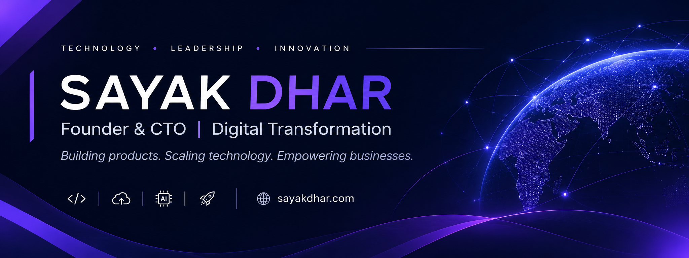

  

<h1 align="center">Sayak Dhar</h1>

<h3 align="center">Founder & CTO · Digital Transformation · Product Engineering</h3>

  Technology entrepreneur and software consultant building meaningful digital products
  and solving complex business challenges through technology.

---

I'm the **Co-Founder & Chief Technology Officer at [Fortmindz](https://fortmindz.com/)**, where I lead technology strategy, software architecture, product engineering, and engineering teams — helping businesses turn ideas into scalable digital solutions.

I enjoy working across the technology lifecycle: understanding business problems, shaping product strategy, designing architectures, and delivering production-ready software.

### What I do

- **Technology leadership:** Technology strategy, engineering leadership, and software architecture.
- **Product engineering:** Web, mobile, SaaS, and enterprise applications.
- **AI & automation:** Practical AI integration, LLM-powered applications, and intelligent workflows.
- **Cloud & infrastructure:** Cloud architecture, DevOps, deployment, and scalable infrastructure.
- **Digital transformation:** Helping businesses modernise operations and build technology-driven capabilities.

### About me

- Co-Founder & CTO at [Fortmindz](https://fortmindz.com/)
- B.Tech in Computer Science & Engineering, University of Engineering & Management, Kolkata.
- Global Cybersecurity Hackathon winner, recognised by the Hon'ble Prime Minister of India.
- Interested in AI, emerging technologies, product innovation, and solving real-world problems.

---

### Technology & tools

**Languages**

  
  
  
  

**Frameworks & platforms**

  
  
  
  
  
  

**Cloud & engineering**

  
  
  
  

**Areas of interest:** AI & LLM integration · SaaS architecture · Product strategy · Cloud infrastructure · DevOps · Automation · Cybersecurity · Digital transformation

---

### Beyond the code

I believe great technology comes from combining strong engineering fundamentals with a deep understanding of business and people.

I enjoy exchanging ideas with founders, collaborating with technology leaders, exploring emerging technologies, and helping engineering teams do their best work.

If you're building something interesting or exploring how technology can solve a business problem, let's connect.

### Recognition & media

- [Global Cybersecurity Hackathon – UEM Kolkata](https://uem.edu.in/news-events/sayak-dhar-cse-saswata-dascse-debanjit-sarkarcse-students-university-engineering-management-uem-kolkata-students-university-engineering-management-uem-kolkata-receiv/)
- [Global Hackathon Award for Trio – The Telegraph](https://www.telegraphindia.com/west-bengal/global-hackathon-award-for-trio/cid/1408241)
- [Meet Kolkata's Student Entrepreneurs – The Times of India](https://timesofindia.indiatimes.com/life-style/spotlight/meet-kolkatas-student-entrepreneurs/articleshow/63881290.cms)
- [Discover How Mediflic is Making the World a Healthier Place](https://www.burstiq.com/discover-how-mediflic-is-making-the-world-a-healthier-place/)
- [Optical Society of America – Student Travel Grant](https://uem.edu.in/news-events/sayak-dhar-2nd-year-student-university-engineering-management-uem-selected-travel-united-states-america-travel-grant-optical-society-america-osa/)

---

### GitHub activity

  
  

  

---

### Let's connect

  
  
  
  

  <em>Building technology. Empowering businesses. Exploring what's next.</em>

